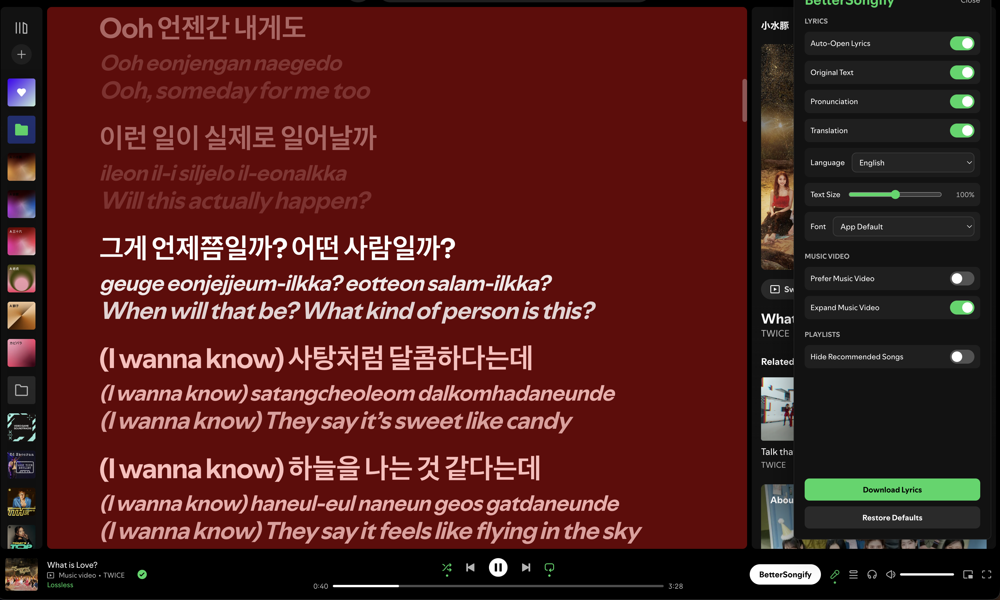
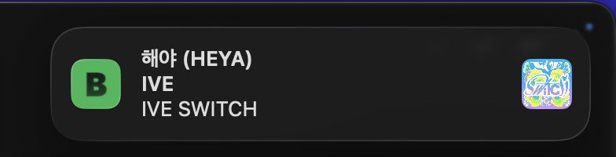
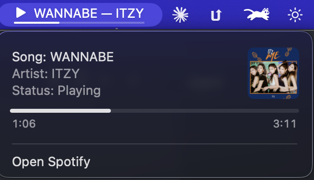

# BetterSongify

[](https://ko-fi.com/orangechuice)

A set of quality-of-life improvements for Spotify's UI: lyric translation and transliteration, sticky music-video preferences, lyrics display controls, playlist cleanups, and — on macOS — native song-change notifications with a menu-bar companion. It ships in two forms: a script injected into the Spotify desktop app, and a Chrome extension for the web player at `open.spotify.com`.

## Features

- **Translated lyrics** — adds translated text below each lyric line using Google Translate.
- **Transliteration / romanization** — shows romanized readings when available (e.g. for Japanese, Korean, Chinese).
- **Dual-language display** — toggle between original-only, translated-only, or side-by-side views.
- **Lyrics style** — text size and font controls for the lyrics view.
- **Auto-open lyrics** — opens the lyrics view once per track change.
- **Sticky music video** — makes "switch to video" genuinely persist across track changes, and optionally re-expands the Now Playing view when a video plays.
- **Hide Playlist Recommendations** — removes the "Recommended" section from the bottom of your own playlists.
- **Hide Home Audiobooks / Podcasts** — drops audiobook and podcast rows from the Home recommendations, individually toggleable. Rows that mix them in with music keep the music.
- **Song-change notifications** — a silent notification for each new track, with artist, album, and cover art.
- **Menu-bar companion (macOS)** — a Dockless menu-bar item showing the current song, artist, playback state and progress, with cover art and full metadata in its menu. Can be switched off from the settings panel.
- **Settings panel** — all of the above via a side panel inside Spotify.
- **Download lyrics** — save the currently displayed lyrics combination (original, pronunciation, translation) as a plain-text file.



### Song-change notifications

Each new track posts one silent notification with the song, artist, and cover art. Each song replaces the previous notification instead of stacking, and nothing fires for the track already playing when Spotify or the page loads. On macOS the metadata is read from Spotify itself, so the notification also carries the album name and full-resolution art.



### Menu bar

On macOS the notification companion also lives in the menu bar, showing the current song and artist with a slim progress line beneath them. Long titles scroll at a constant speed inside a pill whose width stays put, and the item disappears while Spotify is closed. Its menu holds the full song, artist, and playback state alongside the cover art, a track progress bar with elapsed and total time, and a shortcut to bring Spotify forward.

A thin progress line under the title tracks how far into the song you are; opening the menu shows the same progress as a full bar with the elapsed and total time, alongside the song, artist, album art and playback state. **Show Song In Menu Bar** in the BetterSongify panel (under **Notify On Song Change**) hides or restores the item — song-change notifications keep working either way, and the choice is remembered across restarts.



## Getting Started

### Prerequisites

- **Node.js** (any recent LTS version).
- For the desktop target: **macOS** with the Spotify desktop app installed.
- For the web target: **Google Chrome** (or any Chromium browser that loads unpacked extensions).

### Quick Start & Installation

#### Option A: Spotify Desktop App (macOS)

Run the local installer script directly:

```sh
npm run install:macos
```

Additional installer commands:

```sh
npm run reinstall:macos # Clean remove existing injection, then build and inject fresh
npm run remove:macos    # Remove the injection and restore stock Spotify
```

> **Note:** Spotify application updates will overwrite modified interface files. Simply re-run `npm run install:macos` after Spotify updates.

##### Song-change notifications (desktop)

Spotify's desktop client cannot post macOS notifications from inside its own UI, so the installer also installs `BetterSongifyNotifier.app` in `~/Applications`. It is a resident, Dockless menu-bar companion: it shows the authoritative Spotify song, artist, and playback state, scrolls long labels safely, and owns the local notification endpoint on `127.0.0.1:17352`. It stays running while Spotify is closed — hiding its menu-bar item rather than quitting — so it can restore the item the moment Spotify launches again.

The resident companion may request its one-time macOS permissions at different
times, both remembered afterwards:

1. **Automation** — when the companion first refreshes playback shortly after launch while Spotify is running; this supplies artist, album, and cover art.
2. **Notifications** — on the first BetterSongify-triggered song-change notification.

Notifications are attributed to *BetterSongify* rather than Spotify, because macOS ties notification permission to the app that posts them. The installer registers the companion to open at login; that registration is what brings the menu-bar item back after a restart, and it can be switched off in System Settings > General > Login Items. `npm run remove:macos` stops the companion, unregisters its login service, removes any legacy socket LaunchAgent, and removes the app.

Building the helper needs the Xcode Command Line Tools (`xcode-select --install`). Without them everything else still works and song changes appear as an in-app banner instead.

##### Signing the companion

The companion is signed ad-hoc — no certificate, no password prompt, nothing added to your keychain. macOS only requires *a* signature for notifications to work at all, not a signed identity.

Earlier builds created a local self-signed certificate and asked for your login password once to trust it, to keep macOS from mislabelling the menu-bar row. It turned out not to do that: LaunchServices already reports the app as **BetterSongify** under an ad-hoc signature. The two rows that read `BetterSongifyNotifier` — System Settings → Control Center's menu-bar list, and Login Items — use the app bundle's *file name* and ignore its display name, which signing does not change either way.

If you installed one of those earlier builds, `npm run remove:macos` deletes the certificate and its keychain. Should the installer report that a code signing root is still trusted, it was filed in the system keychain and needs one privileged command to clear:

```sh
sudo security delete-certificate -c "BetterSongify Local Signing" /Library/Keychains/System.keychain
```

#### Option B: Web Player (Chrome Extension)

1. Build the extension bundle:
   ```sh
   npm run build:chrome
   ```
2. Open `chrome://extensions` in Google Chrome.
3. Enable **Developer mode** (toggle in top-right corner).
4. Click **Load unpacked** and select the `dist/chrome/` directory in this repository.
5. Open or refresh `open.spotify.com`.

### Building from Source

```sh
npm run build        # Build both targets: dist/BetterSongify.js and dist/chrome/
npm run build:desktop # Build only dist/BetterSongify.js (used by the macOS install)
npm run build:chrome # Build only dist/chrome/ (the Chrome extension)
npm run check        # Syntax-check sources, rebuild, then syntax-check outputs
npm run build:notifier # Build the macOS menu-bar companion
npm run verify:notifier # Verify its plist, resources, signature, identity, and frameworks
npm run test:notifier   # Exercise the native loopback parser without Spotify or notifications
npm run notifier     # Open the built companion for local debugging
```

If the Spotify panel says the companion is unavailable, rebuild/reinstall and
check that the menu-bar item is present. A failed local endpoint always falls
back to BetterSongify's in-app song-change banner. If macOS denies Spotify
Automation or Notifications, the menu remains useful and the menu/status text
points to the missing authority; grant it in System Settings rather than
changing the app identity.

## Support

If you enjoy BetterSongify and find it helpful, consider supporting development on [Ko-fi](https://ko-fi.com/orangechuice)!

[](https://ko-fi.com/orangechuice)

## Disclaimer

- This project is **not affiliated with, endorsed by, or supported by Spotify or Google**. "Spotify" is a trademark of Spotify AB; it is used here only to describe what the project does.
- The desktop install works by modifying local Spotify application files on your machine. Doing so may violate Spotify's Terms of Use. **Use at your own risk** — you are responsible for ensuring you are permitted to inspect and modify those files in your environment.
- Translations use an unofficial, undocumented Google Translate endpoint. Its use is not sanctioned by Google, and it may be rate-limited, blocked, or changed without notice.
- The software is provided as-is, without warranty of any kind. See [LICENSE](LICENSE).

## License

[MIT](LICENSE)
